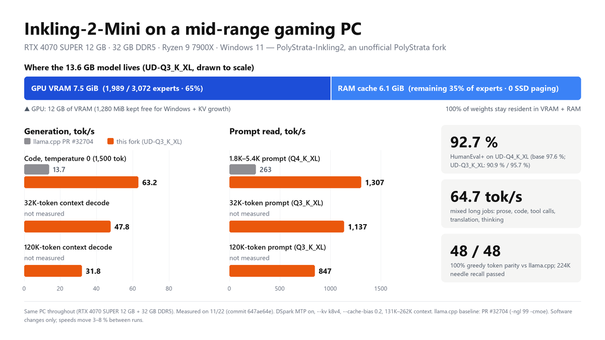

# PolyStrata-Inkling2

[English](README.md) · [简体中文](README.zh-CN.md) · [日本語](README.ja.md) · [Deutsch](README.de.md) · **Français** · [Español](README.es.md) · [Português](README.pt-BR.md) · [Türkçe](README.tr.md)

**Inkling-2-Mini sur un seul GPU 12 Go — fork non officiel de PolyStrata**


PolyStrata-Inkling2 est un fork non officiel de [PolyStrata](https://github.com/VecSzn/PolyStrata) (basé sur [Strata](https://github.com/Niko1221/Strata)) optimisé pour exécuter **Inkling-2-Mini** de Thinking Machines Lab (MoE en boucle à 48 étapes virtuelles, `26B-A3B`) sur **un GPU 12 Go + 32 Go de RAM** sous CUDA (`strata-poly.exe`), avec brouillon spéculatif **DSpark MTP**, cache KV mixte **`--kv k8v4`** / **`q4_0`** et vision déportée sur CPU.

Mesuré sur un seul PC de bureau (`~3–8 %` de variation entre exécutions) ; sans affiliation avec Thinking Machines Lab, Unsloth, Strata ou PolyStrata.

- **Installation rapide :** lancez [START-HERE.bat](START-HERE.bat) (Windows) ou `./setup.sh --family inkling2 --kv k8v4` pour installer l'environnement et télécharger les GGUF vérifiés depuis [`unsloth/Inkling-2-Mini-GGUF`](https://huggingface.co/unsloth/Inkling-2-Mini-GGUF).
- **README d'origine** (les 12 autres modèles) : [README.upstream.md](README.upstream.md) · **Rapport détaillé :** [Inkling 2 Mini Benchmark.md](Inkling%202%20Mini%20Benchmark.md).

## Résultats sur le PC de référence



Ryzen 9 7900X (12C/24T, AVX-512) · RTX 4070 SUPER 12 Go (`sm_89`) · DDR5 32 Go (`31,1 GiB` utilisables) · Windows 11 · modèle : [`unsloth/Inkling-2-Mini-GGUF`](https://huggingface.co/unsloth/Inkling-2-Mini-GGUF) **`UD-Q3_K_XL`** (`13,6 Go`) et **`UD-Q4_K_XL`** (`16,4 GiB`, NVFP4 sur les couches 0–19 + Q8_0 sur 20–23), DSpark MTP actif (`inkling2-dspark.gguf`), `--kv k8v4 --cache-bias 0.2`, contexte `131K–262K`.

| | `llama.cpp` PR `#32704` (`-ngl 99 -cmoe`) | `UD-Q4_K_XL` + DSpark (`k8v4`, NVFP4/Q8) | `UD-Q3_K_XL` + DSpark (`k8v4`, défaut) |
|---|---|---|---|
| Experts résidents en VRAM | 0 / 3 072 (`0 GiB`) | 1 520–1 613 / 3 072 (`7,3–7,5 GiB`) | **1 989 / 3 072 (`7,5 GiB`, 64,7 %)** |
| Code (`temperature 0`, 1 500 tokens, moyenne de 3) | 13,7 tok/s *(décodage 25 tok)* | 55,4 tok/s (`59,1 / 53,0 / 54,2`) | **63,2 tok/s (`61,4 / 65,4 / 62,8`)** |
| Mixed long jobs (`prose, code, outils, traduction, réflexion`) | — | 58,1 tok/s (`50,6 / 62,8 / 81,0 / 46,3 / 49,7`) | **64,7 tok/s (`56,3 / 74,8 / 82,0 / 54,3 / 56,1`)** |
| Décodage pur (figé `--window 1 --no-draft`) | 13,7 tok/s | 47,3 tok/s | **59,7 tok/s** (`2 098` experts) |
| Décodage à 32K de contexte | — | 43,8 tok/s | **47,8 tok/s** |
| Décodage à 120K de contexte | — | — | **31,8 tok/s** |
| Session réelle OpenCode à `181,6K` tokens | — | — | **28,1–30,0 tok/s** |
| Lecture de prompt, 1,8K–5,4K tokens | 263 tok/s *(1,8K)* | **1 307 tok/s** *(5,4K, sans MTP)* | — |
| Lecture de prompt, 32K tokens | — | 1 035 tok/s | **1 137 tok/s** |
| Lecture de prompt, 120K tokens | — | — | **847 tok/s** |
| Parité greedy vs `llama.cpp` | *référence* | **48 / 48 (100 %)** | 48 / 48 *(FP16 & `q8_0` KV)* |
| HumanEval / HumanEval+ (EvalPlus 0.3.1, `temp 0`, effort 0) | — | **97,6 / 92,7 %** (`160 / 152` sur 164) | **95,7 / 90,9 %** (`157 / 149` sur 164) |
| GPQA Diamond (198 questions) | — *(fiche Thinking Machines : 86,6 %)* | non mesuré | non mesuré |

## Ce qui change & compilation

Les optimisations résident dans `src/poly/inkling2.*`, `src/poly/kernels_inkling2.cu` et `src/poly/inkling2_test.cu` (**50 / 50 tests unitaires réussis**) : support natif `inkling2_loop`/`inkling2`, graphe CUDA **DSpark MTP** (`--draft-model`), cache **`--kv k8v4`** / **`q4_0`**, noyau groupé GQA-3, `--cache-bias 0.2` (poids sigmoïdes non biaisés) et addition résiduelle en place (`647ae64e`).

```bat
python setup.py --family inkling2 --model UD-Q3_K_XL --kv k8v4 --context 131072 --yes
.venv\Scripts\python.exe tools\convert_inkling2_dspark.py --out models\inkling2\inkling2-dspark.gguf
```

Compilation Windows (CUDA 13, Ninja) :

```bat
call "C:\Program Files\Microsoft Visual Studio\18\Community\VC\Auxiliary\Build\vcvars64.bat"
cmake -B build-inkling2 -G Ninja -DSTRATA_ENABLE_CUDA=ON -DSTRATA_BUILD_TESTS=ON -DCMAKE_CUDA_ARCHITECTURES=89
cmake --build build-inkling2 --target strata-poly poly_inkling2_test -j 8
```

## Configuration de référence (`UD-Q3_K_XL` + DSpark MTP)

```json
{
  "exe": "D:\\PolyStrata\\engine-poly-inkling2\\strata-poly.exe",
  "args": [
    "--model", "path\\to\\Inkling-2-Mini-UD-Q3_K_XL.gguf",
    "--draft-model", "path\\to\\inkling2-dspark.gguf",
    "--max-context", "262144",
    "--kv", "k8v4",
    "--cache-bias", "0.2",
    "--vram-reserve-mib", "1280",
    "--prompt-batch", "512",
    "--ram-experts-mib", "-1",
    "--expert-profile", "path\\to\\expert-profile.txt",
    "--conversation-cache-mib", "auto"
  ],
  "reasoning_close_retry": true,
  "repeat_stop_tokens": 64
}
```

## Crédits

- [PolyStrata](https://github.com/VecSzn/PolyStrata) ([VecSzn](https://github.com/VecSzn)), [Strata](https://github.com/Niko1221/Strata) ([Niko1221](https://github.com/Niko1221)), Thinking Machines Lab (**Inkling-2-Mini**), [Unsloth](https://huggingface.co/unsloth/Inkling-2-Mini-GGUF), [llama.cpp](https://github.com/ggml-org/llama.cpp) (`PR #32704`) et [midokino/kuu-Strata-fork](https://github.com/midokino/kuu-Strata-fork) pour la mise en page du README et des graphiques.
